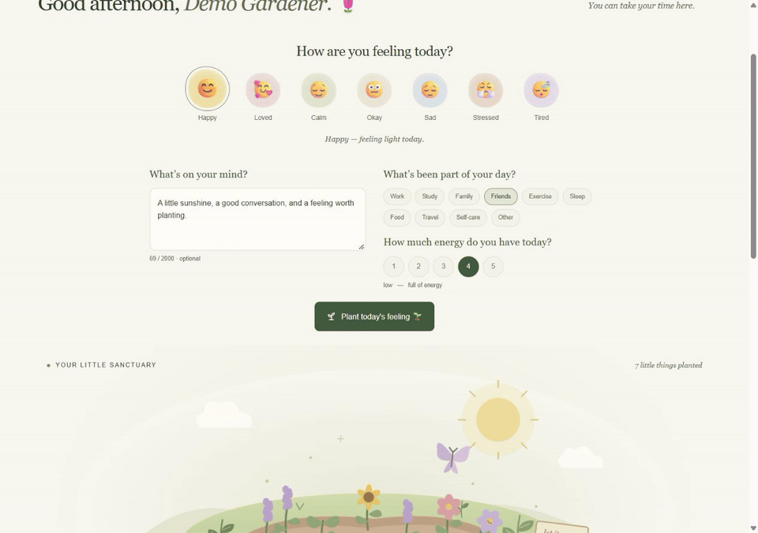
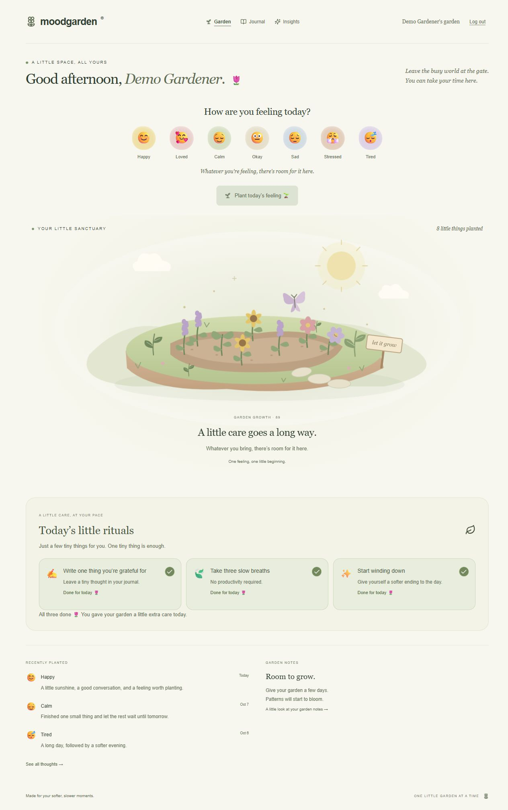
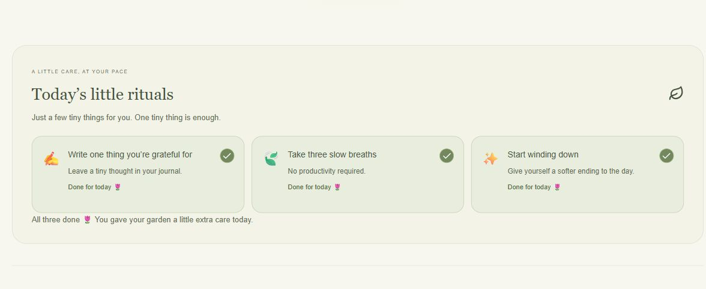
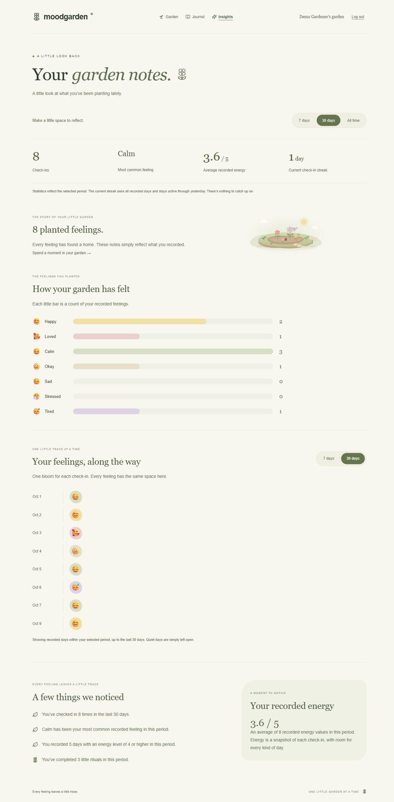

# MoodGarden 🌷

## What is MoodGarden?

A cozy mood-tracking and journaling app where your feelings become a little garden. Record a feeling, leave a thought, and take a small moment for yourself. The garden reflects saved check-ins; daily rituals represent gentle acts of care.

## Features

- **Mood check-ins:** seven feelings, an optional thought, activities, and recorded energy.
- **Persistent garden:** MongoDB-backed feelings become plants, with deterministic positions and a calm planting animation. The latest 12 plants stay visible while every saved feeling counts.
- **Journal:** search, mood filtering, sorting, full-entry dialogs, editing, and confirmed deletion.
- **Daily rituals:** three curated daily invitations, saved completion, and rewards awarded once.
- **Gentle insights:** real mood counts, energy averages, local-calendar check-in streaks, timelines, and descriptive observations.
- **Authentication:** registration, login, JWT-protected pages/APIs, session restoration, and logout.
- **Responsive interface:** cream/sage botanical styling, keyboard controls, visible focus, and reduced-motion support.

## Screenshots

### A feeling becomes a plant



### Your little sanctuary



### Thoughts, care, and a little look back






These five assets show the running app with fictional local demo entries. The GIF records an actual successful API-backed submission, not a mock animation. More mobile screenshots and review evidence are in [docs](docs/).

## Tech Stack

| Area           | Technology                                                                   |
| -------------- | ---------------------------------------------------------------------------- |
| Frontend       | React 19, TypeScript, Vite, React Router, Tailwind CSS, Lucide icons         |
| Backend        | Node.js, Express 5                                                           |
| Database       | MongoDB, Mongoose                                                            |
| Authentication | JWT via jsonwebtoken, bcryptjs                                               |
| Animation      | SVG and CSS transforms/opacity; no JavaScript animation loop or 3D runtime   |
| Tests          | Node test runner, Supertest, isolated real MongoDB via mongodb-memory-server |

## Architecture

```text
React + TypeScript
        ↓ typed HTTP client
REST API / Express
        ↓ owner-scoped queries and validation
Mongoose models
        ↓
MongoDB
```

**MoodEntry is the shared source of truth for Garden, Journal, and Insights.** Garden and Journal use one client history context; successful edits/deletions update that collection. Insights aggregates the same database records server-side. It does not receive journal notes or perform psychological interpretation. Ritual stores daily task snapshots and awarded care separately, without creating additional mood plants.

AuthContext owns the current user and session state. Registration hashes the password with bcrypt cost 12; login compares the hash. Public responses never contain passwordHash. Seven-day JWTs use HS256, issuer/audience checks, expiry validation, and a MongoDB user ID as the subject. Middleware reads a Bearer token and attaches req.user.id. Every data query derives ownership from this ID, ignoring frontend userId values. Late session requests cannot restore a logged-out account or clear a newer login.

The client keeps its Bearer token in localStorage for refresh persistence. Logout removes that browser session. Browser routes are protected, and the server independently authenticates every protected API request.

## Project Structure

```text
client/src/
  components/        Garden, check-in, Journal, rituals, and insight UI
  context/           Authentication and shared mood history
  hooks/             Async flow, retry, and read-cancellation handling
  pages/             Auth, Garden, Journal, and Insights
  services/api.ts    Typed HTTP requests and configured API base
  *.css              Approved styling and accessibility refinements
server/src/
  config/            Validated environment and MongoDB connection
  controllers/       Request validation and HTTP responses
  middleware/        JWT verification and auth attempt limiting
  models/            User, MoodEntry, Ritual
  routes/            REST endpoint mappings
  services/          Deterministic ritual and insight calculations
server/tests/        API, ownership, date, concurrency, and config tests
shared/              Single mood mapping, curated rituals, growth constants
server/scripts/      Local MongoDB helper and backend syntax checks
docs/                Screenshots and final review evidence
```

## Getting Started

Requirements: **Node.js 22.12+** (tested with Node 24), npm, and a MongoDB connection. PowerShell commands are shown; on macOS/Linux use `cp` instead of `Copy-Item`.

```powershell
git clone https://github.com/Ruchi2117/MoodGardern.git MoodGarden
cd MoodGarden
npm ci
Copy-Item server/.env.example server/.env
Copy-Item client/.env.example client/.env
```

Set JWT_SECRET in server/.env to a cryptographically random secret of at least 32 characters. Generate one with:

```powershell
node -e "console.log(require('node:crypto').randomBytes(32).toString('hex'))"
```

Put the result in your local environment file. Never commit it. Set MONGODB_URI to your local MongoDB or managed MongoDB connection.

## Environment Variables

| Variable      | Location           | Meaning                                                                             |
| ------------- | ------------------ | ----------------------------------------------------------------------------------- |
| MONGODB_URI   | Server             | Required database connection URI                                                    |
| JWT_SECRET    | Server             | Required signing secret, at least 32 characters                                     |
| PORT          | Server             | Listening port; defaults to 5000                                                    |
| NODE_ENV      | Server             | development locally; production on hosting                                          |
| CLIENT_ORIGIN | Server             | Exact frontend origin; required in production, no path/trailing slash               |
| HOST          | Server             | Optional; defaults to 127.0.0.1 locally and 0.0.0.0 in production                   |
| TRUST_PROXY   | Server             | Optional trusted proxy-hop count (1–10); omit for direct access                     |
| SERVE_CLIENT  | Server             | Set true to serve the built React client and browser routes from Express            |
| VITE_API_URL  | Client, build time | Empty uses same-origin /api; split hosting uses a full HTTPS API URL ending in /api |

Only VITE_API_URL is public client configuration. Never place database credentials or JWT secrets in a VITE_ variable. Both .env.example files are tracked; actual .env files are ignored.

## Running Locally

If you already run MongoDB, use that service and skip the helper. Otherwise, in terminal one:

```powershell
npm run db:local -w server
```

This helper downloads a real MongoDB binary on first use and runs it on loopback port 27017. WiredTiger files persist in ignored .local/mongodb. Tests use separate temporary databases. The helper is for development; production requires a separately operated or managed MongoDB.

In terminal two:

```powershell
npm run dev
```

Open [http://127.0.0.1:5173](http://127.0.0.1:5173). The API runs at port 5000; Vite proxies /api during development. You can also run each service separately:

```powershell
npm run dev -w server
npm run dev -w client
```

Environment validation, MongoDB connection, and required indexes complete before the API listens. Restart the API after editing server/.env. Client variables require restarting Vite or rebuilding.

## API Overview

Responses use `{data: ...}` or `{error: {message}}`.

| Method | Endpoint                                               | Purpose                                                      |
| ------ | ------------------------------------------------------ | ------------------------------------------------------------ |
| GET    | /api/health                                            | Service health                                               |
| POST   | /api/auth/register                                     | Create account and issue JWT                                 |
| POST   | /api/auth/login                                        | Authenticate and issue JWT                                   |
| GET    | /api/auth/me                                           | Current database user                                        |
| POST   | /api/moods                                             | Save a check-in; current client sends a clientRequestId UUID |
| GET    | /api/moods                                             | Owner’s mood history                                         |
| GET    | /api/moods/:id                                         | Owner’s individual entry                                     |
| PUT    | /api/moods/:id                                         | Validated entry update                                       |
| DELETE | /api/moods/:id                                         | Delete owner’s entry                                         |
| GET    | /api/rituals/today?timeZone=Asia/Kolkata               | Find/create today’s three rituals                            |
| PUT    | /api/rituals/today/tasks/:taskId?timeZone=Asia/Kolkata | Mark done with `{completed:true}`                            |
| GET    | /api/insights?timeZone=Asia/Kolkata&period=30          | Owner’s computed insights; period is 7, 30, or all           |

All endpoints except health, registration, and login require Bearer authentication. Validation failures return 400, invalid sessions 401, inaccessible/missing records 404, duplicate emails/request-key conflicts 409, oversized bodies 413, and excessive authentication attempts 429. Unexpected errors return a safe 500 message without a stack trace.

### Data guarantees

- **Indexes:** unique normalized User.email; MoodEntry user/date reads and partial unique userId/clientRequestId; unique Ritual userId/date. All initialize before the API accepts requests.
- **Safe retries:** an unchanged mood request with the same user-scoped UUID replays the saved entry. Different content under that UUID returns 409. Concurrent requests insert once. Legacy no-key entries remain supported.
- **Growth:** shared/growth.js defines +10 per mood and +3 per ritual, maximum +9 ritual care per local date. Ritual completion and reward update atomically and cannot be repeatedly awarded. Saved care remains across missed days.
- **Local days:** the browser sends its IANA timezone; the server uses its own clock to derive the local YYYY-MM-DD date. Ritual sets are deterministic for user/date. Insights use inclusive calendar-day periods.
- **Streak:** distinct mood check-in days ending today, or yesterday when today is empty, walking backward until a gap. Multiple check-ins per day count once. Rituals never affect it.
- **Honest insights:** explicit most-common ties, averages excluding missing/invalid energy, bounded 30-day timeline, descriptive observations, and appropriate empty/small-data states.

## Testing

```powershell
npm run check
npm test
npm run build
npm audit --omit=dev
```

**48 API tests** cover auth/hash exclusion, invalid and expired JWTs, ownership, validation, CRUD, idempotency, concurrent rituals, one-time growth, insights, missing energy, ties, streaks, timezones, CORS, headers, safe errors, environment validation, auth limiting, production SPA routing and asset caching. GitHub Actions runs checks, tests and the production build on pushes and pull requests.

The test runner uses isolated MongoDB instances and never modifies your application database. First use may download MongoDB. Final browser review covered all six page routes at 320, 375, 390, 430, 768, 1024, 1280, and 1440 pixels; keyboard dialogs/focus/Escape; long notes; empty/single/capped gardens; outage retry states; account isolation; and a simulated expired-session response. See [final review](docs/final-review.md) and [responsive measurements](docs/final-responsive-audit.json).

## Production Deployment

The submission has a **$0 hosting budget**. [Free deployment instructions](docs/free-deployment.md) describe Render Free plus Atlas M0, with no paid resources or payment method. `render.yaml` selects a free single-service Docker deployment. Live provisioning is pending account access; no public URL is claimed yet.

For same-origin deployment, Express serves the built client when `SERVE_CLIENT=true`; leave `VITE_API_URL` empty. For other deployment arrangements:

1. Provision a managed MongoDB database with authentication, backups, TLS, and appropriately restricted network access.
2. Run the backend on a Node-capable host. Set NODE_ENV=production, MONGODB_URI, a fresh JWT_SECRET, PORT, and the exact HTTPS CLIENT_ORIGIN. Use HOST=0.0.0.0 when the host requires it. Set TRUST_PROXY only to the known hop count of the reverse proxy that strips untrusted forwarded headers.
3. Install dependencies with `npm ci`, then run `npm start`. The server connects to MongoDB and verifies indexes before listening. SIGTERM/SIGINT close HTTP connections and disconnect MongoDB. Health endpoint: /api/health.
4. Build the frontend with `npm run build`. Serve client/dist from a static host. For split frontend/API hosting, set VITE_API_URL=https://your-api-host/api **before the build**. For same-origin hosting, keep it empty and reverse-proxy /api to Express.
5. Configure SPA fallback: requests for /login, /register, /dashboard, /journal, and /insights must serve index.html when they are not static assets. Preserve /api routing separately.
6. Terminate HTTPS at the hosting edge. Add frontend security headers there (a CSP compatible with this app’s inline style attributes, frame protection, and a referrer policy). The API already sends no-store, nosniff, frame protection, and exact-origin CORS headers. Apply shared edge rate limits when using multiple API instances.
7. Verify registration/login, refresh, logout, a mood save/edit/delete, ritual persistence, Insights, and direct route navigation against the deployed URLs. Monitor sanitized server logs and MongoDB availability.

The auth limiter is process-local: 20 login/registration attempts per IP per 15 minutes, with Retry-After. It reduces repeated bcrypt work; it is not a replacement for a shared gateway limiter at scale.

## AI Development Experience

**Actual tools used: Codex for implementation and verification, plus Kiro CLI 2.27.1 for four final source reviews.** [Kiro evidence](docs/kiro-review.md) includes actual responses, accepted/rejected findings and validation. Kiro reviewed authentication/ownership, retry/concurrency behavior, date/Insight calculations, and deployment configuration. Its suggested prior-day ritual retry test was implemented and passes.

Five real Codex-assisted tasks performed on this project:

1. Developed the React garden, check-in, Journal, ritual, and Insights components while preserving the approved botanical design.
2. Built Mongoose models and Express APIs for authentication, mood CRUD, daily rituals, and computed insights.
3. Investigated duplicate mood retries and concurrent ritual completion, adding unique indexes and atomic updates.
4. Added API integration tests and checked ownership, timezones, missing energy, ties, and streak edge cases.
5. Reviewed accessibility, responsive layouts, async failure states, production configuration, and documentation.

Generated code was inspected, modified, built, and tested. Browser testing identified real focus, contrast, overflow, and recovery issues which were corrected. Kiro findings were checked against source rather than automatically accepted; the evidence retains its incorrect and self-corrected claims.

## Design Philosophy

**Feelings become plants, and small rituals become acts of care.** Every mood has room in the garden. Rituals are invitations, with no penalties for missed days. Insights describe what was recorded; they do not diagnose or interpret emotional health.

## Explaining the project

- [Two-minute architecture explanation and live demo outline](docs/architecture-talk.md)
- [Why I built it this way: interview answers and tradeoffs](docs/design-decisions.md)
- [Recruiter submission review](docs/submission-review.md)

## Known Limitations and Future Improvements

- History is unpaginated for this assessment-sized dataset; explicit pagination is the main scaling improvement. Visible garden rendering stays capped at 12 plants.
- Timeline is limited to the latest 30 calendar days, including for all-time statistics.
- Timezone follows the active browser; travel can regroup historical mood timestamps. Ritual dates retain their saved local-day identity.
- Concurrent entry edits use last-write-wins. Multi-query Insights are near-current rather than a transactional snapshot.
- Browser localStorage exposes Bearer tokens to scripts running on the page. HttpOnly-cookie sessions with CSRF protection and server revocation are possible production hardening; copied JWTs currently remain valid until expiry.
- Optional future garden customization/themes or a contained 3D scene could build on the existing renderer. They are not needed for the complete assessment product.

## Submission Checklist

- [x] Core MERN functionality and all 48 API tests
- [x] Production build and code checks
- [x] Accessibility/contrast and responsive review
- [x] Local secrets, database files, dependencies, and generated builds excluded from Git
- [x] Actual Kiro review evidence required by the assessment
- [x] Five real showcase screenshots/GIFs and an architecture walkthrough
- [x] Configure the candidate’s GitHub remote
- [x] Publish the reviewed repository and verify remote CI
- [ ] Provision and smoke-test a free public deployment

Repository: [Ruchi2117/MoodGardern](https://github.com/Ruchi2117/MoodGardern). A live deployment is pending Render/Atlas account access. The local project can be reviewed and run with the commands above.
